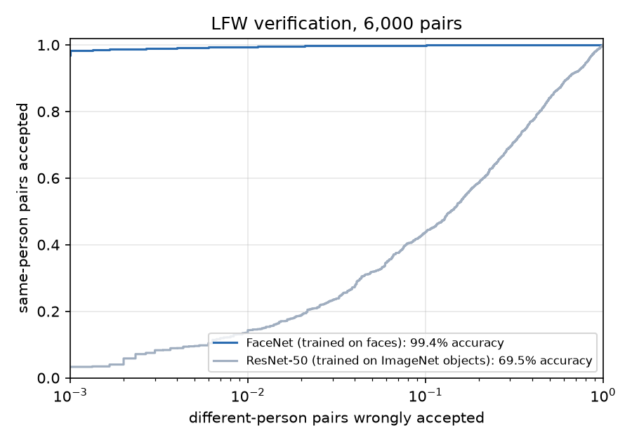
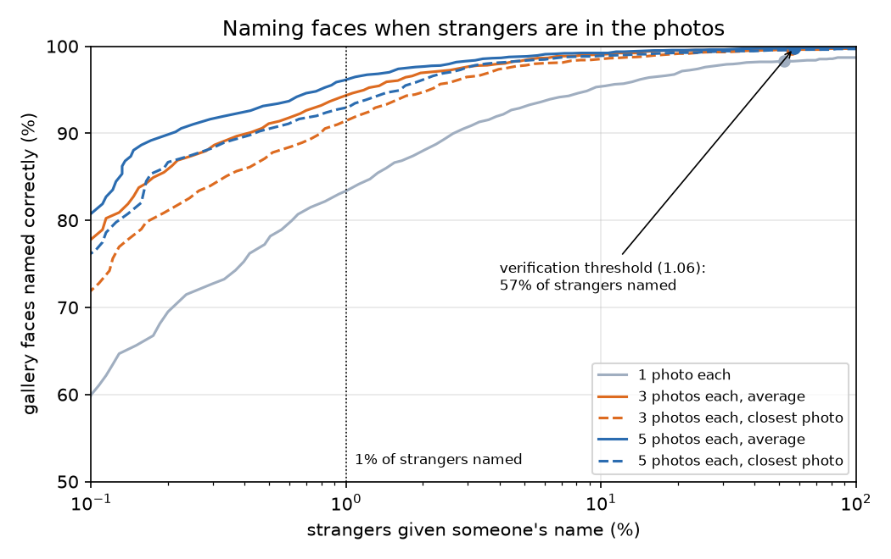
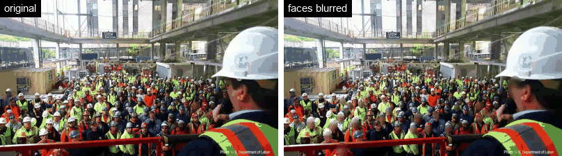
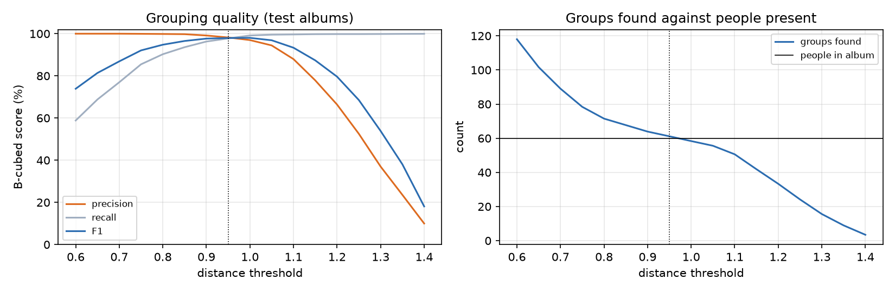
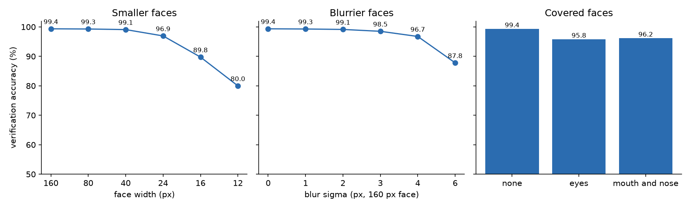

# Face Recognition

[](https://github.com/Gauhet/face-recognition/actions/workflows/tests.yml)

Finds faces in photos and video and tells you who they are, whether two photos show the same
person, and which photos in an album belong together. It can also blur the faces in a video.
It uses a pretrained face detector (MTCNN) and face embedding network (FaceNet), and measures them
on Labeled Faces in the Wild (LFW): **99.35% verification accuracy**, and **96% of faces named
correctly while only 1% of strangers are named as someone**.


<sub>NASA video and photos, public domain. Each astronaut was added from four photos: an official portrait and three ISS photos from other days. The video clip was never seen beforehand.</sub>

## What a 99% score hides

Verification compares two photos: are they the same person? On LFW's 6,000 test pairs, FaceNet
gets 99.35% right with a distance threshold of 1.06.

Naming a face is a different question. The face is compared with *everyone* in the gallery, and a
stranger who comes close to any one of them gets that person's name. I added 155 LFW people to a
gallery and tested it with 5,594 photos of people who weren't in it. At the verification threshold,
**52 to 78% of the strangers were named as someone**.

A closed-set matcher, which gives every face the name of the closest person, names 100% of
strangers. Getting strangers right needs a stricter threshold, chosen for the size of the gallery.

## Results

### Verification

| Embedding | Accuracy (10-fold) | Same-person pairs accepted with 1% false accepts | ... with 0.1% false accepts |
|-|-|-|-|
| **FaceNet** (Inception-ResNet V1 trained on VGGFace2 faces) | **99.35% ± 0.32** | **99.5%** | **98.4%** |
| ResNet-50 trained on ImageNet objects | 69.48% ± 1.52 | 14.3% | 3.3% |

<sub>LFW's standard protocol: 6,000 pairs in 10 folds; for each fold, the threshold is chosen on the other nine. Both networks see the same face crops.</sub>



The ImageNet network is a strong image model, but it was trained to tell objects apart, and to it
most faces look alike: at 1% false accepts it recognises only 14% of same-person pairs. Training
on faces is what makes this work.

### Naming faces with strangers present

| Gallery | Threshold | Gallery faces named correctly | Strangers named as someone |
|-|-|-|-|
| 1 photo per person | 1.06 (verification) | 98.3% | **52.1%** |
| 1 photo per person | 0.80 | 83.0% | 0.9% |
| 3 photos, compared with their average | 0.78 | 94.1% | 0.9% |
| 3 photos, compared with the closest one | 0.76 | 91.0% | 0.9% |
| **5 photos, compared with their average** | **0.78** | **96.1%** | **1.0%** |
| 5 photos, compared with the closest one | 0.745 | 92.7% | 0.9% |

<sub>155 LFW people in the gallery, 573 test photos of them (never the photos they were added from) and 5,594 strangers, one photo each. Averaged over 5 random choices of who is in the gallery. Each strict threshold is the loosest that names at most 1% of strangers.</sub>



- **More photos help.** At 1% of strangers named, going from one photo per person to five
  raises correct names from 83% to 96%.
- **Average the photos.** Comparing a face with the average of a person's photos beats comparing
  it with their closest photo (96.1% against 92.7%). Matching the closest photo gives a stranger
  more chances to land near one unusual photo.
- **The threshold depends on the gallery size.** The more people in the gallery, the more chances
  a stranger has. The app defaults to 0.78, the 5-photo threshold above, and has a slider.
- These strict thresholds were chosen on the same test runs they're reported on, so the
  percentages are a best case.

### Video: tracking faces across frames

Each video frame gives a new embedding of every face, and a turned head or motion blur can push one
across the threshold. Naming each frame on its own makes names flicker. The tracker links faces
from frame to frame by box overlap (or by embedding, if a face jumps) and names each track from the
average of its recent embeddings.

On the 15-second ISS clip above (449 frames, 2 people):

| Gallery | Threshold | Faces named, frame by frame | Faces named, with tracking | Name changes: frame by frame → tracked |
|-|-|-|-|-|
| 1 official portrait each | 0.78 | 1.6% | 1.3% | 12 → 2 |
| Portrait + 3 ISS photos each | 0.78 | 47.9% | 67.6% | 202 → 24 |
| Portrait + 3 ISS photos each | 0.90 | 99.0% | **100%** | 12 → **0** |

One studio portrait (Mike Fincke's is from 2019) isn't enough: the astronauts' faces in the video are
0.88 and 0.97 away from their portraits, so at the strict threshold they stay unknown. Three photos
from other days on the ISS bring them closer.

The GIF uses 0.9. With a gallery of only two people, a stranger has two chances to match instead of
155, and in LFW's test only 2 of 3,000 different-person pairs are closer than 0.9.

### Blurring faces in video



<sub>Footage: U.S. Department of Labor (OSHA), public domain.</sub>

Every detected face is pixelated and blurred under an oval that's larger than the detector's box,
so hair and ears are covered too. In blur mode the tracker matters for a different reason: a face
the detector misses for a single frame would flash into view. When a track loses its face, the last
box stays blurred for up to 10 frames (a third of a second). On this crowd clip (264 frames,
8,756 face detections), that kept **3,930 more face-frames hidden**.

It doesn't catch everything. MTCNN finds faces turned towards the camera, so the man in profile in
the foreground isn't blurred. A real anonymisation tool would need a detector trained on profile
faces, or would blur whole people.

The app can also leave people in the gallery visible and blur everyone else.

### Grouping an album by person

Faces are grouped without any names, by agglomerative clustering: groups merge while their faces
are, on average, closer than a threshold. I tested it on 20 pretend albums, each with 40 people who
have several photos (up to 15) plus 20 people seen once, about 190 photos in all. The threshold
(0.95) was chosen on albums made from a different half of LFW's people.

| | Precision | Recall | F1 |
|-|-|-|-|
| B-cubed (averaged over photos) | 98.2% | 97.8% | **98.0%** |
| Pairs of photos | 96.4% | 96.8% | 96.4% |

On average it found 61.2 groups for 60 people.



### Robustness

What happens when the second photo of every LFW pair is degraded (the first stays clean):



- **Size:** accuracy holds at 99% down to faces 40 pixels wide and falls to 80% at 12 pixels.
  That's why the OSHA crowd clip (faces about 16 pixels wide) can be blurred but not recognised.
- **Blur:** fine up to a blur of 3 pixels on a 160-pixel face, then drops quickly.
- **Covered faces:** a black band over the eyes (like sunglasses) or over the mouth and nose (like a
  mask) costs 3 to 3.5 points. That still leaves 96%, but the error rate goes from 0.65% to about
  4%, six times higher.

The degraded photos use the face boxes found in the clean ones, so this measures the embedding
network, not the detector.

## Limitations

- **The model may have seen the test people.** A later paper counts 496 LFW people who are also in
  VGGFace2, the dataset FaceNet was trained on
  ([Git Loss, arXiv 1807.08512](https://arxiv.org/abs/1807.08512)). The LFW numbers are probably
  a little optimistic for people the model has never seen.
- **LFW isn't representative.** Its photos are news photos of public figures, mostly of white men
  (about three quarters male and over 80% white, per Han and Jain, 2014). I didn't measure
  accuracy by group, and it is likely to be lower for groups the training data has fewer of.
- **Thresholds come from LFW.** Different cameras and lighting move distances around, as the ISS
  clip shows. Thresholds for a real system should be measured on its own photos.

## How it works

- **Faces** ([`faces.py`](src/facerec/faces.py)): MTCNN finds faces and their boxes. Each face is cropped
  with a small margin, resized to 160×160 and passed through FaceNet, which returns 512 numbers
  scaled to length 1. Distances between embeddings run from 0 to 2.
- **Verification** ([`verify.py`](src/facerec/verify.py)): the 10-fold threshold and the accept rates.
- **Naming** ([`identify.py`](src/facerec/identify.py)): a gallery of people with one or more embeddings
  each, compared by average or closest photo, with "unknown" above the threshold; and the
  strangers test.
- **Grouping** ([`cluster.py`](src/facerec/cluster.py)): agglomerative clustering, with B-cubed and
  pairwise scores.
- **Video** ([`video.py`](src/facerec/video.py)): the tracker, track-level naming, and blurring with
  held boxes.
- **Drawing** ([`draw.py`](src/facerec/draw.py)): labelled boxes and oval blurring.
- **Evaluation** ([`evaluate.py`](src/facerec/evaluate.py)): everything above on LFW, plus the
  figures. LFW photos are centred on the person they're labelled with, so when the detector finds
  several faces the one nearest the centre is used.

## Running it

Requires Python 3.10+. Install PyTorch for your hardware first
([pytorch.org](https://pytorch.org/get-started/locally/)), then the package and facenet-pytorch:

```bash
git clone https://github.com/Gauhet/face-recognition.git
cd face-recognition
pip install -e ".[dev,demo]"
pip install --no-deps facenet-pytorch==2.6.0
```

facenet-pytorch is installed without its dependencies because it pins PyTorch 2.2, but it works
unchanged with current versions (tested with PyTorch 2.11).

Evaluate on LFW and regenerate the figures in `assets/`. The first run downloads LFW (about 180 MB)
and the model weights, and computes embeddings for all 13,233 photos (about 10 minutes on a laptop
GPU); later runs use the cached embeddings.

```bash
python -m facerec.evaluate
```

Try it in the browser. The tabs add people, name faces in a photo, compare two faces, group an
album, blur faces, and process video (naming or blurring, up to 20 seconds).

```bash
python app.py   # then open http://localhost:7860
```

Run the tests:

```bash
pytest
```

## Project layout

```
src/facerec/
  data.py       LFW download and the official test pairs
  faces.py      face detection and embeddings
  verify.py     same person or not: thresholds and accept rates
  identify.py   naming faces from a gallery, with strangers
  cluster.py    grouping an album by person
  video.py      face tracking, naming and blurring in video
  draw.py       labelled boxes and face blurring
  evaluate.py   LFW evaluation and figures
app.py          browser demo (Gradio)
tests/          data, verification, naming, grouping, tracking and drawing checks
results/        LFW metrics and video demo counts
assets/         figures and GIFs used in this README
```

## What I'd try next

- Choose the naming threshold from the gallery size automatically, since the chance of a
  stranger matching someone grows with the number of people.
- Use a detector that finds faces in profile, for blurring that misses less.
- Measure accuracy across demographic groups on a balanced test set.

## Data and credits

- **Labeled Faces in the Wild** (Huang et al., 2007, University of Massachusetts Amherst), via the
  scikit-learn mirror.
- **facenet-pytorch** by Tim Esler ([MIT licence](https://github.com/timesler/facenet-pytorch)):
  the MTCNN detector and the Inception-ResNet V1 network with VGGFace2 weights. VGGFace2 is
  licensed for non-commercial research.
- **ISS video and astronaut photos:** NASA, public domain, via Wikimedia Commons (ISS in-flight
  event, 27 August 2025; official portraits; ISS photos iss073e0814456, iss073e0818458,
  iss073e0982912, iss073e0917875, iss073e0982894, iss073e1193970).
- **Crowd footage:** U.S. Department of Labor (OSHA), public domain, via Wikimedia Commons.

I first worked with MTCNN and FaceNet in WorldQuant University's *Deep Learning for Computer Vision*
lab. This repository is my own implementation on public data, written from scratch; it contains no
course material.

## License

[MIT](LICENSE)
